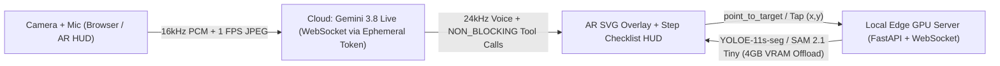

# AI Glasses MVP — Hybrid Cloud + Local Edge GPU AR Repair Assistant

A real-time multimodal Augmented Reality (AR) repair & assembly guidance prototype combining **Gemini 3.8 Live** (bidirectional voice + 1 FPS camera reasoning) with a **local NVIDIA GPU Vision Server** (**YOLOE-11s-seg** + **SAM 2.1 Tiny**) for zero-cloud-quota pixel-level object segmentation and tracking.

## Architecture Overview



### Key Engineering Decisions

- **Hybrid Cloud + Edge Split:** Cloud multimodal reasoning (`gemini-3.8-live`) handles natural voice guidance and task planning, while high-frequency pixel-level tracking (~20 FPS) runs locally on GPU — eliminating cloud vision quota costs and network round-trip lag.
- **4 GB VRAM Optimization (GTX 1650 Ti):** Dynamic CPU/GPU model offloading (`_offload_other`) keeps only the active segmentation model (`YOLOE-11s-seg` or `SAM 2.1 Tiny`) in VRAM to prevent OOM errors.
- **Strict WebSocket Backpressure:** The browser `GpuVisionClient` enforces a single in-flight frame lock (`inFlight`) so frame queues never build up lag on slower hardware.
- **Non-Blocking Live Tooling:** All three Gemini Live tools (`set_task_plan`, `update_step`, `point_to_target`) use `Behavior.NON_BLOCKING` so voice streaming remains fluid while local GPU models initialize.
- **Server-Issued Ephemeral Tokens:** `server/index.ts` mints single-use ephemeral tokens (`v1beta`) so `GEMINI_API_KEY` is never exposed to the browser.

## Tech Stack

- **Frontend & AR HUD:** TypeScript, Vite 6, Web Audio `AudioWorklet` (16kHz in / 24kHz out), SVG Spatial Overlay (`object-fit: cover` coordinate projection)
- **Cloud Live AI:** `@google/genai` (`gemini-3.8-live`), Ephemeral Auth Tokens
- **Local GPU Vision Server:** Python, FastAPI, WebSockets, PyTorch (CUDA FP16), Ultralytics `YOLOE-11s-seg`, `SAM 2.1 Tiny`, OpenCV

## Quick Start

```powershell
# 1. Configure environment
Copy-Item .env.example .env
# Add GEMINI_API_KEY to .env

# 2. Install frontend/server dependencies
npm install

# 3. Start Token Server + Vite Client + Local GPU Vision Server
npm run dev
```
